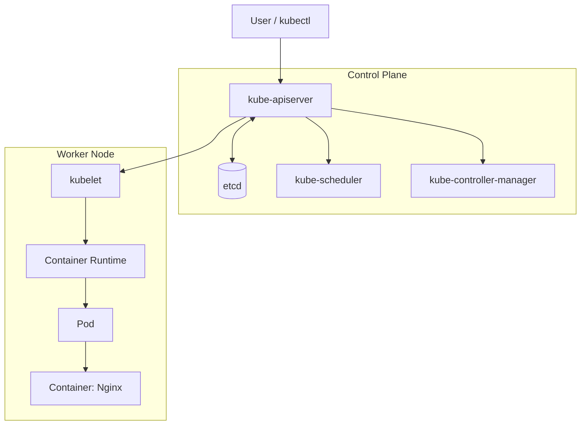

<p align="center">
  
</p>

<h1 align="center">Kubernetes</h1>

<p align="center">
  <strong>Fundamentals • Architecture • Minikube • Hands-on Learning</strong>
</p>

<p align="center">
  
  
  
</p>

---

## About This Repository

This repository documents my hands-on journey learning Kubernetes, starting with its fundamentals and architecture and moving toward real-world container orchestration.

I use this repository to keep my study notes, terminal commands, architecture diagrams, YAML examples, and practical progress organized in one place. The content will grow as I learn and practice more Kubernetes concepts.

## Learning Progress

| Day | Topics | Status |
|---|---|---|
| Day 01 | Fundamentals, architecture, deployment models, Minikube installation, and Nginx Pod practice | Completed |

## Technology Stack

| Layer | Technology |
|---|---|
| Containerization | Docker |
| Container Orchestration | Kubernetes |
| Local Kubernetes Environment | Minikube |
| Kubernetes CLI | kubectl |
| Container Runtime Inspection | crictl |
| Workload Example | Nginx |
| Configuration | YAML |
| Documentation | Markdown, Mermaid |
| Version Control | Git and GitHub |

## Kubernetes Architecture

A Kubernetes cluster is organized into a control plane and one or more worker nodes.



The diagram is a simplified learning view. Kubernetes components communicate through the API server; the kubelet on a worker node works with the container runtime to run assigned Pods.

### Core Components

| Component | Responsibility |
|---|---|
| kube-apiserver | Exposes the Kubernetes API and acts as the control plane entry point. |
| etcd | Stores cluster state and configuration data. |
| kube-scheduler | Assigns newly created, unscheduled Pods to suitable nodes. |
| kube-controller-manager | Runs controllers that reconcile actual state with desired state. |
| kubelet | Ensures assigned Pods are running on its node. |
| Container Runtime | Pulls images and runs containers. |
| Pod | Smallest deployable unit in Kubernetes; contains one or more containers. |

## Day 01 - Learning Summary

- Understood what Kubernetes is and why container orchestration is needed.
- Explored automated scheduling, self-healing, scaling, and workload management.
- Learned the high-level history of Kubernetes, including Google's Borg and Omega systems.
- Compared physical server, virtual machine, container, and Kubernetes-based deployment models.
- Studied cluster architecture, control plane components, worker nodes, and Pods.
- Learned about Minikube, kind, and kubeadm.
- Explored managed Kubernetes services: Amazon EKS, Google GKE, and Azure AKS.
- Installed Minikube and practiced running an Nginx workload in a local cluster.

For the full study notes, see [Day 01 Fundamentals](docs/day-01-fundamentals.md).

For a structured overview of the day's learning, architecture, and YAML example, see [Day 01 Learning Report](docs/day-01-learning-report.md).

## Useful Commands

### Minikube

```bash
# Check cluster status
minikube status

# List local profiles
minikube profile list

# Start the local cluster
minikube start
```

### kubectl

```bash
# List cluster nodes
kubectl get nodes -o wide

# List Pods in the current namespace
kubectl get pods

# List Pods across all namespaces
kubectl get pods -A

# Run an example Nginx Pod
kubectl run nginx --image=nginx

# Check Pod status
kubectl get pods
```

### Container Runtime Inspection

```bash
# Enter the Minikube node
minikube ssh

# Inspect CRI runtime information
crictl info

# List containers known to the CRI runtime
crictl ps

# List images known to the CRI runtime
crictl images
```

> **Runtime note:** `docker ps` lists containers managed by the Docker Engine selected by the Docker CLI. A Minikube node may use containerd internally, in which case `crictl` is useful for inspecting Kubernetes workload containers from inside the node. The Minikube driver and the node's container runtime are separate settings.

## Example Kubernetes YAML

The following is a sample Deployment manifest for learning. It is an example configuration, not a claim that this exact manifest was applied during Day 01.

```yaml
apiVersion: apps/v1
kind: Deployment
metadata:
  name: nginx
  labels:
    app: nginx
spec:
  replicas: 1
  selector:
    matchLabels:
      app: nginx
  template:
    metadata:
      labels:
        app: nginx
    spec:
      containers:
        - name: nginx
          image: nginx:stable
          ports:
            - name: http
              containerPort: 80
```

## Repository Structure

```text
k8s-fundamentals/
├── README.md
└── docs/
    ├── day-01-fundamentals.md
    └── day-01-learning-report.md
```

## Learning Roadmap

- [ ] Pods and multi-container Pods
- [ ] Labels and Selectors
- [ ] ReplicaSets and Deployments
- [ ] Services and service discovery
- [ ] Namespaces
- [ ] ConfigMaps and Secrets
- [ ] Resource requests and limits
- [ ] Volumes and persistent storage
- [ ] Ingress and networking
- [ ] Health probes
- [ ] Rolling updates and rollbacks
- [ ] Horizontal Pod Autoscaling
- [ ] Helm and package management

## Managed Kubernetes Services

| Cloud Provider | Service |
|---|---|
| AWS | Amazon Elastic Kubernetes Service (EKS) |
| Google Cloud | Google Kubernetes Engine (GKE) |
| Microsoft Azure | Azure Kubernetes Service (AKS) |

## References

- [Kubernetes Documentation](https://kubernetes.io/docs/)
- [Kubernetes Concepts](https://kubernetes.io/docs/concepts/)
- [Minikube Documentation](https://minikube.sigs.k8s.io/docs/)
- [kind Documentation](https://kind.sigs.k8s.io/)
- [kubeadm Documentation](https://kubernetes.io/docs/reference/setup-tools/kubeadm/)

---

<p align="center">
  Learning by doing • One concept at a time
</p>
