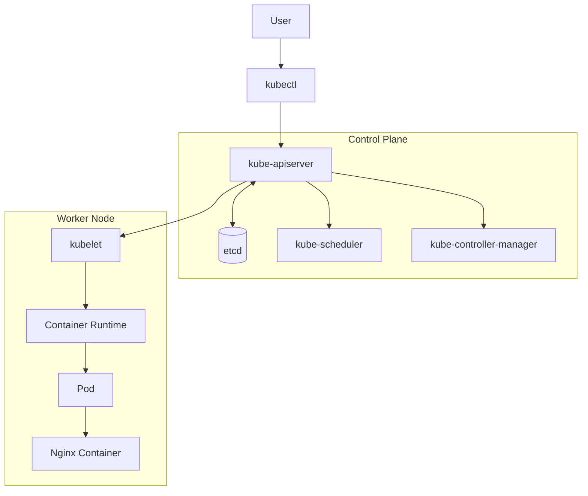

# Day 01 - Kubernetes Learning Report

**Date:** November 1, 2026  
**Focus:** Kubernetes fundamentals, architecture, and local environment setup  
**Environment:** Local Minikube cluster

---

## 1. Learning Objective

The objective of this session was to understand the purpose of Kubernetes, learn its basic architecture, compare common application deployment approaches, and set up a local Kubernetes environment for hands-on practice.

## 2. What Is Kubernetes?

Kubernetes (K8s) is an open-source container orchestration platform. It helps deploy, manage, and scale containerized applications across a cluster of machines.

Its important capabilities include:

- Automated scheduling of Pods onto suitable nodes.
- Self-healing by restarting or replacing failed workloads according to their configuration.
- Scaling application workloads by changing replica counts.
- Rolling updates and rollbacks.
- Service discovery and load balancing.
- Configuration and storage management.

Kubernetes manages workloads according to the desired state declared by the user. It does not automatically fix application bugs or write application updates.

## 3. Background and History

Google's experience operating large-scale workloads influenced Kubernetes. Borg was Google's internal cluster-management system, and Omega was a later research system. Their ideas and operational experience helped shape Kubernetes.

- 2014: Google announced Kubernetes as an open-source project.
- 2015: Kubernetes 1.0 was released and the project was contributed to the Cloud Native Computing Foundation (CNCF).

Kubernetes was influenced by Borg and Omega; it is not simply a renamed version of either system.

## 4. Deployment Evolution

| Deployment approach | Description |
|---|---|
| Physical / Traditional | Applications run directly on physical servers. |
| Virtual Machines | A hypervisor runs multiple isolated virtual machines on physical hardware. |
| Containers | Applications and dependencies are packaged into containers that share the host OS kernel. |
| Container Orchestration | Kubernetes coordinates containerized workloads across a cluster. |

Docker is commonly used to build and run containers. Kubernetes is used to orchestrate containerized workloads, especially when they need to run across a cluster.

## 5. Kubernetes Architecture

A Kubernetes cluster consists of a control plane and worker nodes.

### Control Plane

| Component | Purpose |
|---|---|
| kube-apiserver | Provides the Kubernetes API and central communication entry point. |
| etcd | Stores cluster state and configuration. |
| kube-scheduler | Selects a node for each newly created, unscheduled Pod. |
| kube-controller-manager | Runs controllers to reconcile actual state with desired state. |
| cloud-controller-manager | Integrates with a cloud provider when required. |

### Worker Node

| Component | Purpose |
|---|---|
| kubelet | Ensures Pods assigned to the node are running. |
| Container Runtime | Pulls images and runs containers, for example containerd or CRI-O. |
| kube-proxy | Provides Service-related network forwarding in many cluster configurations. |

### Simplified Architecture Diagram



This is a simplified conceptual diagram. The API server is the central API endpoint; controllers and the scheduler observe cluster state and help achieve the declared desired state.

## 6. Pods

A Pod is the smallest deployable unit in Kubernetes.

- A Pod can contain one or more containers.
- Containers in the same Pod share the Pod's network namespace.
- Containers in the same Pod can communicate using localhost.
- A Pod is scheduled onto one worker node.

Most Pods contain one application container. Multiple containers are useful when they need to work closely together, such as an application and a sidecar.

## 7. Kubernetes Setup Tools

| Tool | Use |
|---|---|
| Minikube | Creates a local Kubernetes cluster for learning and development. |
| kind | Runs Kubernetes clusters using Docker container nodes, useful for local testing. |
| kubeadm | Bootstraps and configures Kubernetes clusters, often for self-managed environments. |

These tools have different purposes. Minikube and kind are convenient for local labs; kubeadm is a cluster bootstrap tool.

## 8. Practical Work - Minikube

During this session I:

1. Installed Minikube.
2. Explored the local Kubernetes environment and cluster configuration.
3. Checked the cluster and node information.
4. Ran an Nginx workload inside the Minikube cluster.
5. Explored commands for inspecting Pods and the container runtime.

### Commands for Revision

```bash
# Check Minikube status
minikube status

# List Minikube profiles
minikube profile list

# Start Minikube
minikube start

# Get cluster nodes
kubectl get nodes -o wide

# List Pods in the current namespace
kubectl get pods

# List Pods across all namespaces
kubectl get pods -A

# Run an Nginx Pod (example)
kubectl run nginx --image=nginx

# Check the Pod
kubectl get pods
```

### Inspecting the Container Runtime

```bash
# Enter the Minikube node
minikube ssh

# Runtime details
crictl info

# Running containers known to CRI
crictl ps

# Images known to CRI
crictl images
```

To inspect the runtime version reported by Kubernetes:

```bash
kubectl describe node minikube | grep -i "Container Runtime"
```

### Docker CLI and CRI Tools

- `docker ps` lists containers managed by the Docker Engine selected by the Docker CLI.
- `crictl ps` lists containers known to a CRI-compatible runtime.
- Minikube can use a Docker driver while the Kubernetes node itself uses containerd.
- Therefore, the Docker CLI may not show the Kubernetes workload containers running inside the Minikube node.

## 9. Example Deployment YAML

This manifest is a learning example showing how a Deployment can declare one Nginx replica. It is provided for future practice and is not a record that this exact YAML was applied during this session.

```yaml
apiVersion: apps/v1
kind: Deployment
metadata:
  name: nginx
  labels:
    app: nginx
spec:
  replicas: 1
  selector:
    matchLabels:
      app: nginx
  template:
    metadata:
      labels:
        app: nginx
    spec:
      containers:
        - name: nginx
          image: nginx:stable
          ports:
            - name: http
              containerPort: 80
```

## 10. Monolithic and Microservices

### Monolithic Architecture

A monolithic application is packaged and deployed as one main unit. It can be a practical choice for smaller applications and teams.

### Microservices Architecture

A microservices application is divided into smaller services that can be developed, deployed, and scaled independently. This can improve flexibility but introduces distributed-system complexity.

Kubernetes can run both monolithic and microservices applications. Kubernetes does not require microservices.

## 11. Why Use Kubernetes Instead of Only Docker?

Docker is useful for building images and running containers, especially in local development and simpler deployments.

Kubernetes is useful when workloads need cluster scheduling, desired-state management, service discovery, scaling, rolling updates, and self-healing across multiple nodes.

Kubernetes introduces additional operational complexity and infrastructure overhead. It is not necessary for every application.

## 12. Managed Kubernetes Services

| Cloud Provider | Managed Service | Full Name |
|---|---|---|
| AWS | EKS | Amazon Elastic Kubernetes Service |
| Google Cloud | GKE | Google Kubernetes Engine |
| Microsoft Azure | AKS | Azure Kubernetes Service |

Managed services reduce the need to operate the Kubernetes control plane directly. Teams still manage their workloads, access, configuration, and many operational responsibilities.

## 13. Key Takeaways

- Kubernetes is an open-source container orchestration platform.
- A cluster has a control plane and worker nodes.
- The API server is the central Kubernetes API endpoint.
- etcd stores cluster state.
- The scheduler assigns Pods to nodes.
- kubelet manages assigned Pods on each node.
- A Pod can contain one or more containers.
- Minikube, kind, and kubeadm are different setup tools.
- EKS, GKE, and AKS are managed Kubernetes services.
- Kubernetes is powerful, but not required for every application.

## 14. Next Learning Plan

- [ ] Pods in more detail
- [ ] Labels and Selectors
- [ ] ReplicaSets
- [ ] Deployments
- [ ] Services
- [ ] Namespaces
- [ ] ConfigMaps and Secrets
- [ ] Requests, limits, and resource management
- [ ] Volumes and persistent storage
- [ ] Ingress and networking
- [ ] Health probes
- [ ] Scaling and rolling updates

## 15. References

- [Kubernetes Documentation](https://kubernetes.io/docs/)
- [Kubernetes Concepts](https://kubernetes.io/docs/concepts/)
- [Minikube Documentation](https://minikube.sigs.k8s.io/docs/)
- [kind Documentation](https://kind.sigs.k8s.io/)
- [kubeadm Documentation](https://kubernetes.io/docs/reference/setup-tools/kubeadm/)

---

**Personal learning note:** This report records my Day 01 learning and practice. It is not official Kubernetes documentation.
